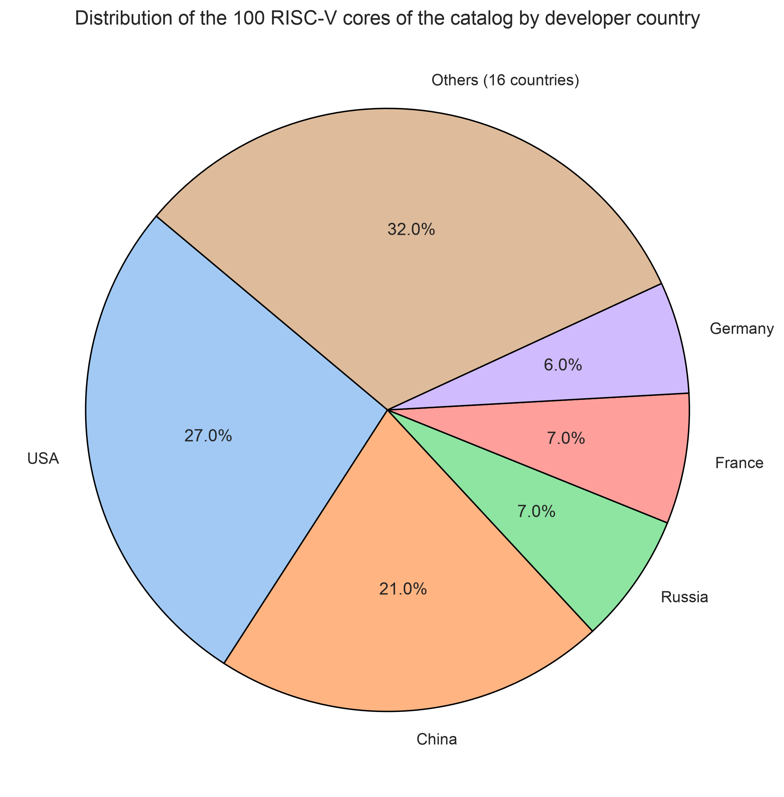
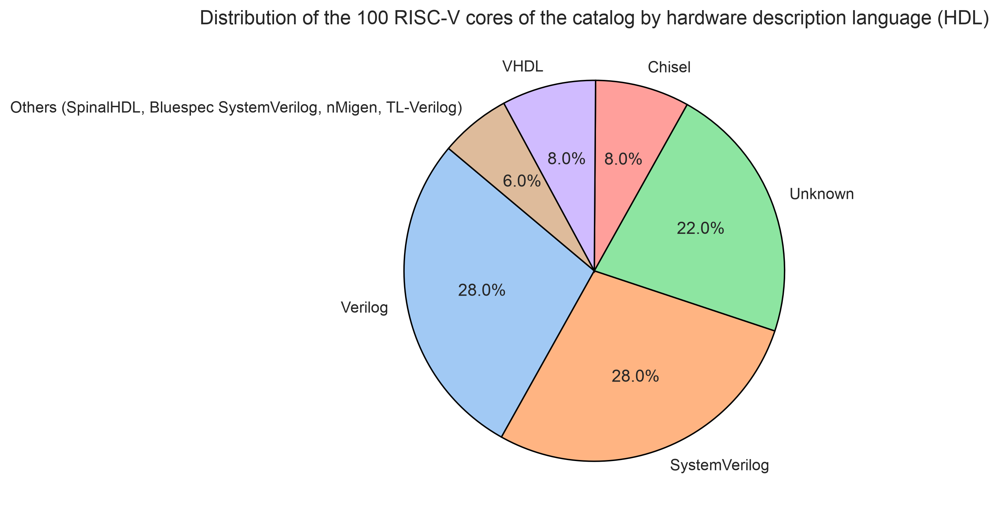
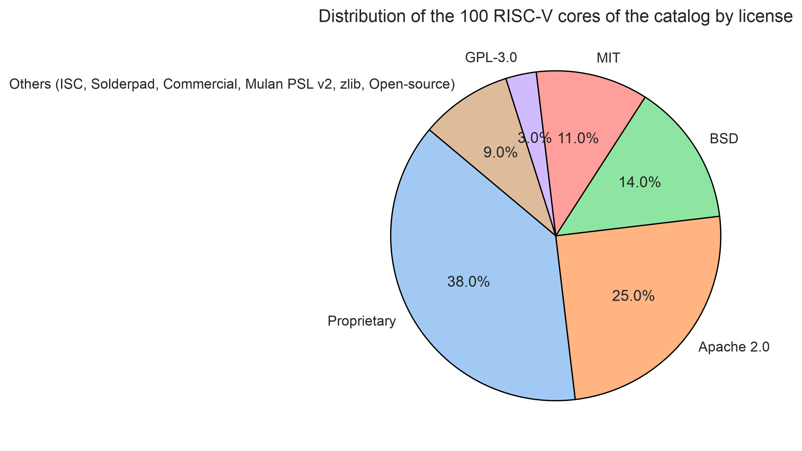
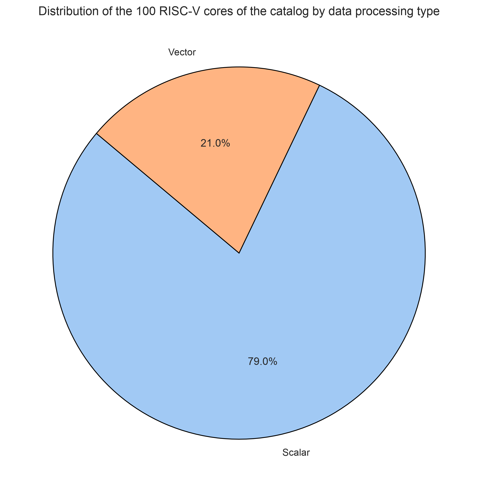

# Development of a RISC-V cores repository and classifier

RISC-V cores table: [RISC-V_cores_database.xlsx](results/RISC-V_cores_database.xlsx)

## Introduction

The repository "Development of a RISC-V cores repository and classifier" was created within a project aimed at collecting, systematizing, classifying and analyzing open-source implementations of RISC-V processor cores. The main goal of the project is to create a unified repository that allows:

1. storing and structuring data on existing RISC-V RTL cores;

2. performing their comparative analysis by technical and architectural characteristics;

3. providing reproducible synthesis of selected cores using open PDKs (SKY130, GF180MCU);

4. providing developers and researchers with tools for a well-grounded choice of an implementation suitable for a specific design task.

The repository includes several key components:

1. A database of 100 RISC-V core implementations;

The summary table (Excel) contains information on each core:
core name, link, description, classification attributes, architecture (bits), OS support, target application, features, license, developer country, developer, release date, core support status, data processing type, HDL language, microarchitecture implementation, instruction support, core application.

2. A classification tree in PDF format;

It presents the visual structure of the core attributes and is used for visual comparison of cores and navigation through the database.

3. Core designs selected for synthesis with OpenLane;

The `designs/` catalog contains the source files of 15 cores in Verilog, which are successfully synthesized in the OpenLane environment without critical errors, and flow configuration files (`config.json`; for ibex and serv — `config.tcl`) defining the parameters of the design flow. The catalog also contains the `spm` design — the standard regression design of the OpenLane flow (it is not part of the cores database).

4. Synthesis results of the cores on two PDKs.

PDKs used: sky130A and gf180mcuC. The numerical results are in the `designs/results/` directory (see the "Results database" section).

Future plans:

1. expanding the database of RISC-V implementations;

2. adding new PDKs (e.g. ASAP7 for research tasks);

3. synthesizing a larger number of IP cores.

## Results database

The `designs/results/` directory contains all numerical results of the project:

| File | Description |
|---|---|
| `sky130A_metrics/*.csv` | 15 files (one per run): 93 columns — all flow metrics, run configuration and its tag |
| `gf180mcuC_metrics/*.csv` | 13 files, same format |
| `metrics_summary.csv` | summary table for all 28 runs: area, utilization, cell count, wire length and vias, timing (WNS/TNS), power, runtimes, configuration and tag of each run |
| `RISC-V_cores_database.xlsx` | catalog of 100 cores, 18 attributes |
| `classification_tree.pdf` | classification tree |

The runs were performed in the OpenLane 2 container (the version is pinned in `flake.nix`/`flake.lock`: rev e56eac03 dated 06.09.2024) with the `run_designs.py` script. All runs used a 100 ns (10 MHz) clock period constraint. The run tag and the full set of configuration overrides (FP_CORE_UTIL, STD_CELL_LIBRARY and others) are recorded in the `config` column of the corresponding CSV file.

Notes on the metrics:

- WNS = 0.0 means that the 100 ns constraint is met. OpenSTA truncates a positive timing margin to zero, so the actual margin (and the exact Fmax) is unknown for such cores. Fmax is given only for cores that violate the constraint.
- Power — an OpenSTA estimate (report_power, typical corner: internal + switching + leakage), obtained without signal activity data (default input activity is used).
- The cell count is given for the post-synthesis netlist; the final netlist additionally contains fill elements (fill, decap, well-tap) and has a larger cell count.
- Die area strongly depends on the chosen value of FP_CORE_UTIL (10–50 %), so a direct comparison of area metrics between cores without normalization is not informative.

## Distribution of cores by attributes

Based on the collected RISC-V cores database, the diagrams below reflect the distribution of implementations by the main classification attributes.

### Distribution by developer country

  

  Fig. 1 — Distribution of IP cores by developer country.

The "Developer country" field contains 21 unique values. The largest shares are held by: USA — 27 % of implementations, China — 21 %, Russia — 7 %, France — 7 %.
The distribution confirms the active participation of China and the USA in the development of the RISC-V architecture. European countries and Russia are represented by smaller shares, which reflects the global but uneven character of the development distribution.

### Distribution by HDL language

  

  Fig. 2 — Distribution of IP cores by HDL language.

The "HDL language" field contains 9 unique values. The largest shares are held by: Verilog — 28 %, SystemVerilog — 28 %, unknown — 22 %; followed by Chisel — 8 %, VHDL — 8 %, SpinalHDL — 2 %, Bluespec SystemVerilog — 2 %, nMigen — 1 %, TL-Verilog — 1 %.
The distribution of the "HDL language" field shows that the main hardware description languages used in the development of RISC-V cores are Verilog and SystemVerilog, which account for more than half of all implementations. This reflects their status as the most widespread tools in the digital design industry. The significant share of the "Unknown" category (22 %) indicates incomplete data due to closed repositories.

### Distribution by license

  

  Fig. 3 — Distribution of IP cores by license.

The "License" field contains 11 unique values. The largest shares are held by: proprietary — 38 %, Apache 2.0 — 25 %, BSD — 14 %; followed by MIT — 11 %, GPL-3.0 — 3 %, ISC — 2 %, Solderpad — 2 %, commercial — 2 %, Mulan PSL v2 — 1 %, zlib — 1 %, open-source — 1 %.
The analysis of the "License" field distribution shows that most RISC-V core implementations are distributed under proprietary licenses (38 %), which indicates a significant share of closed or commercial developments. At the same time, Apache 2.0 (25 %) and BSD (14 %) hold notable positions, reflecting the active use of open licenses in academic and research projects. This balance demonstrates the coexistence of both open and commercial approaches in RISC-V implementations.

### Distribution by data processing type

  

  Fig. 4 — Distribution of IP cores by data processing type.

The "Data processing type" field contains 2 unique values. The scalar type — 79 %, vector — 21 %.
The "Data processing type" field shows that the overwhelming majority of RISC-V core implementations belong to the scalar data processing type (79 %). This indicates the prevalence of compact and universal solutions aimed at embedded and basic computing systems. Vector cores (21 %) hold a smaller share, which is explained by their higher complexity and narrow specialization, predominantly in high-performance and research projects.

## Classification tree

## Core synthesis

In this project, a comparative synthesis of 15 RISC-V cores (on sky130A) and 13 of them (on gf180mcuC) was performed using OpenLane, a popular tool for automated ASIC physical design. The goal of the comparison is to evaluate the key metrics of each core, including:

1) Area and utilization: die area (Die Area), core area (Core Area), standard-cell area, utilization (Core Util), number of cells (Cells);

2) Timing: WNS and TNS timing margins from the signoff static timing analysis under a 100 ns (10 MHz) clock period constraint;

3) Power consumption (Power) — an OpenSTA estimate, typical corner;

4) Routing complexity (Wire Length, Vias);

5) Flow runtime (Total Runtime, Routed Runtime).

Comparing the cores is necessary for choosing an optimal solution for specific requirements: high performance, compactness, low power consumption, or a balance between all parameters. This is especially important when integrating processors into SoCs, where resources are limited.

The numerical results of each run (all 93 flow metrics, run configuration and its tag) are stored as CSV files in the `designs/results/` directory (see the "Results database" section).

## Table for PDK Sky130A

The table presents the synthesis results of 15 RISC-V cores in the SkyWater 130 nm (sky130A) standard-cell library.

| Design | Top Module | Total Runtime | Routed Runtime | Core Util (%) | Die Area (mm²) | Std-Cell Area (mm²) | Cells (after synthesis) | Wire Length (µm) | Vias | WNS (ns) | TNS (ns) | Timing @100 ns | Power (mW) |
|---|---|---|---|---|---|---|---|---|---|---|---|---|---|
| cv32e40p | cv32e40p_core | 1h2m50s | 0h44m31s | 42.34 | 0.584 | 0.236 | 21301 | 1247091 | 199434 | 0.00 | 0.0 | met | 2.245 |
| darkriscv | darkriscv | 0h30m31s | 0h26m4s | 61.46 | 0.181 | 0.102 | 7471 | 339394 | 67472 | 0.00 | 0.0 | met | 2.810 |
| fedar-f1 | CPU | 5h26m52s | 4h46m28s | 27.45 | 1.811 | 0.484 | 54118 | 3048005 | 438939 | -247.83 | -18278.6 | violated | 247.401 |
| femtorv32_petitbateau | FemtoRV32 | 1h30m43s | 0h55m18s | 23.85 | 1.680 | 0.390 | 33204 | 3383382 | 326538 | 0.00 | 0.0 | met | 69.400 |
| femtorv32_quark | FemtoRV32 | 0h12m32s | 0h8m48s | 62.21 | 0.161 | 0.092 | 6351 | 283972 | 56940 | 0.00 | 0.0 | met | 3.290 |
| hazard3 | hazard3_core | 0h28m38s | 0h21m38s | 58.59 | 0.259 | 0.142 | 11160 | 473599 | 96726 | 0.00 | 0.0 | met | 3.951 |
| ibex | ibex_core | 1h6m10s | 0h55m22s | 55.32 | 0.340 | 0.177 | 14839 | 807876 | 138186 | 0.00 | 0.0 | met | 14.273 |
| miriscv | miriscv_core | 0h41m43s | 0h27m0s | 34.31 | 0.731 | 0.241 | 19355 | 1290821 | 172071 | 0.00 | 0.0 | met | 2.283 |
| picorv32 | picorv32 | 0h21m16s | 0h16m33s | 61.22 | 0.208 | 0.118 | 8680 | 446448 | 80167 | 0.00 | 0.0 | met | 2.410 |
| riscv-crypto | riscv_crypto_fu | 0h22m44s | 0h16m13s | 31.07 | 0.263 | 0.076 | 6932 | 444256 | 62129 | 0.00 | 0.0 | met | 3.850 |
| schoolriscv | sm_top | 0h7m41s | 0h5m40s | 51.87 | 0.119 | 0.055 | 5308 | 156365 | 36211 | 0.00 | 0.0 | met | 0.101 |
| scr1 | scr1_core_top | 1h59m58s | 1h22m9s | 33.03 | 0.909 | 0.289 | 26166 | 1581000 | 233467 | 0.00 | 0.0 | met | 10.322 |
| serv | serv_top | 0h3m18s | 0h2m2s | 9.64 | 0.160 | 0.014 | 856 | 67090 | 7870 | 0.00 | 0.0 | met | 0.300 |
| ssrv | ssrv_top | 7h3m42s | 3h6m12s | 13.36 | 6.941 | 0.915 | 72592 | 9195263 | 772050 | 0.00 | 0.0 | met | 52.707 |
| vexriscv | VexRiscv | 0h13m13s | 0h9m5s | 61.79 | 0.199 | 0.114 | 8120 | 366402 | 69401 | 0.00 | 0.0 | met | 2.620 |

Notes:

- Timing: 100 ns (10 MHz) clock period constraint. WNS = 0.0 — the constraint is met (the margin is unknown, see the "Results database" section).
- fedar-f1: constraint violation — worst signoff path 347.83 ns, Fmax ≈ 2.87 MHz.
- Power — an OpenSTA estimate, typical corner (no activity data). For runs that violate the constraint, the constrained operating point is unrealizable (Fmax < 10 MHz), so the power value is not interpretable as the core's power consumption.
- Cells — the cell count of the post-synthesis netlist.
- The run tag and configuration of each core — in the corresponding CSV file in `sky130A_metrics/` (the `config` column).

## Table for PDK gf180mcuC

The table presents the synthesis results of 13 RISC-V cores in the GlobalFoundries 180 nm MCU (gf180mcuC) standard-cell library. Run results for cv32e40p and ibex on gf180mcuC are not available.

| Design | Top Module | Total Runtime | Routed Runtime | Core Util (%) | Die Area (mm²) | Std-Cell Area (mm²) | Cells (after synthesis) | Wire Length (µm) | Vias | WNS (ns) | TNS (ns) | Timing @100 ns | Power (mW) |
|---|---|---|---|---|---|---|---|---|---|---|---|---|---|
| darkriscv | darkriscv | 0h10m3s | 0h5m55s | 64.66 | 2.320 | 0.352 | 8050 | 781932 | 89585 | 0.00 | 0.0 | met | 53.904 |
| fedar-f1 | CPU | 5h26m8s | 4h36m30s | 44.14 | 21.280 | 2.300 | 65045 | 6124273 | 591805 | -495.25 | -36414.9 | violated | 173900.0 |
| femtorv32_petitbateau | FemtoRV32 | 1h11m26s | 0h34m42s | 21.96 | 31.123 | 1.679 | 37438 | 7621747 | 454136 | 0.00 | 0.0 | met | 1452.0 |
| femtorv32_quark | FemtoRV32 | 0h9m16s | 0h4m58s | 49.03 | 2.769 | 0.320 | 7084 | 724954 | 76147 | 0.00 | 0.0 | met | 51.104 |
| hazard3 | hazard3_core | 0h21m0s | 0h10m29s | 52.43 | 4.374 | 0.549 | 14406 | 1308899 | 152307 | 0.00 | 0.0 | met | 122.007 |
| miriscv | miriscv_core | 0h23m30s | 0h12m11s | 50.86 | 7.008 | 0.859 | 21061 | 2132143 | 217586 | 0.00 | 0.0 | met | 44.711 |
| picorv32 | picorv32 | 0h11m59s | 0h7m1s | 64.00 | 2.672 | 0.403 | 9212 | 860573 | 99136 | 0.00 | 0.0 | met | 47.105 |
| riscv-crypto | riscv_crypto_fu | 0h9m32s | 0h5m14s | 53.86 | 1.993 | 0.251 | 6188 | 688371 | 70106 | 0.00 | 0.0 | met | 483.003 |
| schoolriscv | sm_top | 0h5m34s | 0h3m45s | 69.59 | 1.328 | 0.213 | 5767 | 385396 | 48178 | 0.00 | 0.0 | met | 2.072 |
| scr1 | scr1_core_top | 1h24m57s | 0h41m11s | 53.81 | 8.693 | 1.133 | 28377 | 3140255 | 315074 | -17.63 | -21.1 | violated | 89.114 |
| serv | serv_top | 0h2m4s | 0h1m21s | 30.39 | 0.640 | 0.043 | 944 | 80954 | 9377 | 0.00 | 0.0 | met | 4.181 |
| ssrv | ssrv_top | 4h6m30s | 1h27m31s | 24.03 | 67.893 | 4.033 | 83109 | 14797978 | 1052763 | -4.72 | -24.1 | violated | 977.064 |
| vexriscv | VexRiscv | 0h13m4s | 0h7m39s | 62.46 | 2.613 | 0.385 | 10566 | 800749 | 106624 | 0.00 | 0.0 | met | 65.505 |

Notes:

- Timing: 100 ns (10 MHz) clock period constraint. WNS = 0.0 — the constraint is met (the margin is unknown, see the "Results database" section).
- Constraint violations: fedar-f1 — worst signoff path 595.25 ns (Fmax ≈ 1.68 MHz); scr1 — 117.63 ns (Fmax ≈ 8.50 MHz); ssrv — 104.72 ns (Fmax ≈ 9.55 MHz).
- Power — an OpenSTA estimate, typical corner (no activity data). For runs that violate the constraint, the constrained operating point is unrealizable (Fmax < 10 MHz), so the power value is not interpretable as the core's power consumption.
- Cells — the cell count of the post-synthesis netlist.
- The run tag and configuration of each core — in the corresponding CSV file in `gf180mcuC_metrics/` (the `config` column).

## Results analysis for PDK Sky130A

1. Timing

14 of the 15 cores meet the 100 ns clock period constraint. A violation is recorded for fedar-f1: WNS = −247.83 ns, TNS = −18278.6 ns, worst signoff path 347.83 ns (Fmax ≈ 2.87 MHz).

2. Area

Smallest die area: schoolriscv — 0.119 mm². Largest: ssrv — 6.941 mm².

Core utilization varies from 9.64 % (serv) to 62.21 % (femtorv32_quark). Since each core used its own value of the FP_CORE_UTIL parameter, area metrics between cores are not directly comparable.

3. Power consumption (estimate)

Smallest: schoolriscv — 0.101 mW. Largest: fedar-f1 — 247.401 mW.

4. Routing

The largest wire length and via count are for the large cores (ssrv, femtorv32_petitbateau, fedar-f1); the smallest — for serv and schoolriscv.

## Results analysis for PDK gf180mcuC

1. Timing

10 of the 13 cores meet the 100 ns clock period constraint. Violations are recorded for: fedar-f1 (WNS = −495.25 ns, worst signoff path 595.25 ns, Fmax ≈ 1.68 MHz), scr1 (WNS = −17.63 ns, 117.63 ns, Fmax ≈ 8.50 MHz), ssrv (WNS = −4.72 ns, 104.72 ns, Fmax ≈ 9.55 MHz).

2. Area

Smallest die area: serv — 0.640 mm². Largest: ssrv — 67.893 mm².

3. Power consumption (estimate)

Smallest: schoolriscv — 2.072 mW. Largest: fedar-f1 — 173.9 W.

4. Routing

The largest routing load is for the ssrv core; the smallest — for serv.

## Conclusion

The flow was completed for all 28 runs; a violation of the 100 ns constraint is recorded in 4 runs (fedar-f1 on both PDKs, scr1 and ssrv on gf180mcuC). The choice of the "optimal" core is determined by the requirements of the specific task: in terms of die area, schoolriscv and serv are the most compact, the maximum utilization is achieved by schoolriscv (69.59 % on gf180mcuC), and the minimum estimated power consumption is achieved by schoolriscv and serv. Direct comparison of the cores is limited by the differences in their architectures, supported ISA extensions, and used values of FP_CORE_UTIL.

